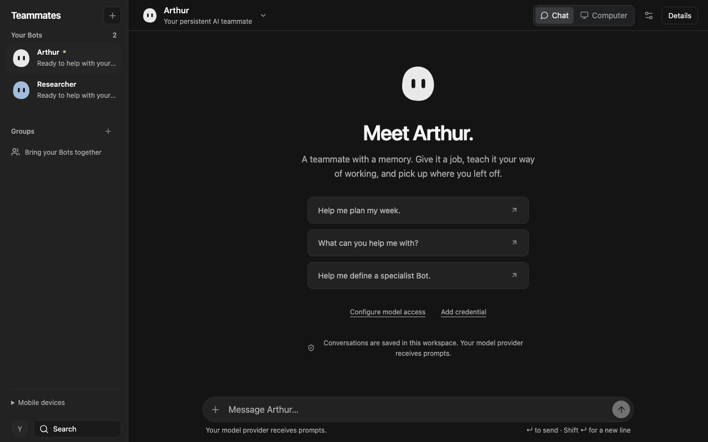
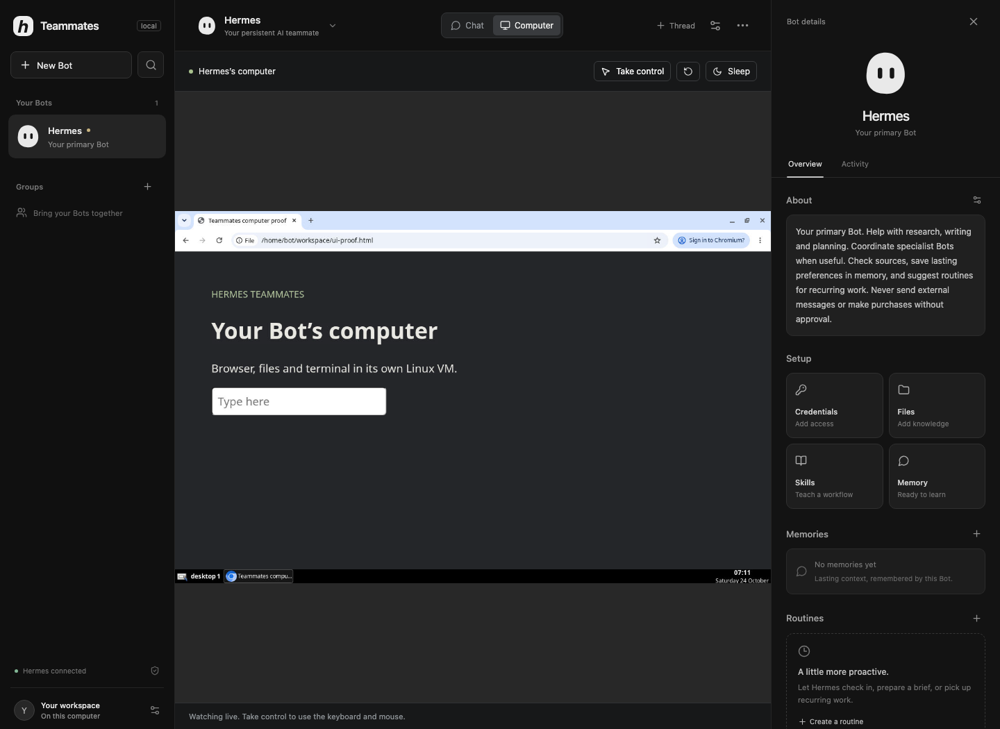

# Hermes Teammates

An original, MIT-licensed desktop workspace for persistent Hermes agents, inspired by Grok Bot's dark, three-column interface. Hermes runs the agents; this app gives them a roster, conversations and a details panel.



_Actual compiled interface with controlled integration-test content._

Each Bot has a role, model configuration, conversation history, memory, skills, workspace files and credential file. Bots can hand work to one another through Hermes' native `message_agent` tool. Groups bring multiple Bots into one visible conversation. Routines use Hermes' own cron store and scheduler. Each Bot can also have its own Linux computer with a live screen and manual takeover.

**First local release:** this is a working foundation, not full Grok Bot feature parity. See [the feature audit and alternatives](docs/research.md), [architecture and security boundaries](docs/architecture.md), and [verification](docs/verification.md).

## Run

Requirements: Node.js 24+, npm, and a working [Hermes Agent installation](https://hermes-agent.nousresearch.com/docs/getting-started/installation). Install and configure Hermes separately before launching. This app disables Hermes' automatic dependency installation during agent runs.

```sh
npm ci
npm run build
npm start
```

Open <http://127.0.0.1:4310>. For a native Electron window:

```sh
npm run desktop
```

Development: `npm run dev`. Produce an unpacked desktop app: `npm run package:desktop` (platform signing/distribution is a separate release step).

## Model access

Every Bot can choose its own provider in **Bot settings**.

- **Claude through Hermes:** add `ANTHROPIC_API_KEY` in that Bot's Credentials, or explicitly enable reuse of an existing Claude Code login. Hermes owns authentication and billing. Its current provider documentation says Claude Max OAuth requires extra usage credits; do not assume an existing subscription includes these calls. This is Hermes' native Anthropic integration, not a bundled Claude Agent SDK runtime.
- **OpenAI-compatible API / Ollama:** enter the endpoint's `/v1` base URL and its exact model ID. Add `OPENAI_API_KEY` in that Bot's Credentials if required. Examples include OpenAI Chat Completions and local Ollama or vLLM endpoints. The model must support tool calling for agent workflows. Endpoints that require the Responses API are not supported by this first UI.

For native Claude support on managed Hermes installations, prepare its optional SDK before starting the app: `hermes pm install --extra anthropic`. The app does not install missing provider packages during a turn.

No real model credentials are included. The integration test uses a controlled local model endpoint while exercising the real Hermes CLI and native tools.

## Use

1. Open **New Bot**, give it a name and job, and select its model access.
2. Add the relevant credentials, text files, memory or SKILL.md workflows in Bot details.
3. Send a task. The transcript shows replies, tool results, question forms and approval cards; **Activity** shows tools, handoffs and outcomes. Answer a card to continue. While it works, send steering to the next tool result or press **Stop**. Ask a Bot to message a named teammate when a specialist should help.
4. Create a group with at least two Bots for a shared discussion. Members answer sequentially using their own Hermes profiles.
5. Create a routine for recurring work. Hermes accepts cron expressions, `every 2h`, or an ISO timestamp. New routines deliver their results into **Bot Chat**, with an attributed routine card and a reply from that Bot. The original output remains in **Routines → Run results**.

Unread badges on Bots, conversations and groups survive reloads and backend restarts. Opening a focused Chat view marks only the messages it has loaded as read. Viewing the Computer tab does not clear conversation unread state. Existing native routines retain their configured delivery destination; recreate an older local-only routine to opt into Bot Chat delivery.

Routines run while the backend is running. Closing the desktop app quits its backend. Sleeping the computer pauses local work. For an always-on service, run the backend on an awake machine; authenticated remote access and service installation are not included here.

## Bot computers

On Apple silicon with macOS 26 or later, install [Apple container](https://github.com/apple/container):

```sh
brew install container
container system start
```

Open a Bot’s **Computer** tab and choose **Set up computer**. The first start builds
a Debian desktop image with Chromium, Openbox and a terminal (roughly 500 MB
compressed; allow several minutes). Each running desktop uses two CPUs and 2 GB
of memory. Subsequent starts reuse the image. Hermes needs its MCP SDK installed;
managed installations can prepare it with `hermes pm install --extra mcp`.

Watch the live screen, **Take control** to use its keyboard and mouse, then
**Hand back** so the Bot can continue. The Bot uses the same desktop through
`computer_screenshot`, `computer_action` and `computer_shell` MCP tools. Its home,
files and browser logins survive sleep. Idle desktops sleep after 20 minutes;
manual control keeps them awake. Closing the app stops its owned desktops.

Screenshots use Hermes’ native image cache. Visual navigation requires a configured
vision model for `vision_analyze`; shell and manual browser control work independently.



VM files live in per-Bot Apple container named volumes. The host **Files** panel
and the guest `~/workspace` are separate; there is no automatic host mount or file
sync. Model credentials stay with Hermes on the host. Native host tools still
run under your account, so enabling a computer does not sandbox the whole agent.
Computers currently require macOS; the rest of the interface can run without them.

## Storage and runtime configuration

The browser backend defaults to `~/.hermes-teammates`. Electron uses its OS application-data directory. To use the same data in either mode, set `TEAMMATES_DATA_DIR` to an absolute directory. The app does not import or change existing personal Hermes profiles.

| Variable              | Purpose                                                                                                            |
| --------------------- | ------------------------------------------------------------------------------------------------------------------ |
| `TEAMMATES_DATA_DIR`  | App metadata and dedicated Hermes profile root                                                                     |
| `TEAMMATES_CONTAINER` | Optional absolute path to Apple’s `container` executable                                                           |
| `PORT`                | Loopback HTTP port, default `4310`                                                                                 |
| `HERMES_EXECUTABLE`   | Hermes executable, default `~/.local/bin/hermes`                                                                   |
| `HERMES_PYTHON`       | Python interpreter for native interactive chat and routines; discovered from modern Hermes launchers when possible |
| `HERMES_SOURCE`       | Hermes source directory for the Python bridge; default `~/.hermes/hermes-agent`                                    |
| `HERMES_RUNTIME_DIR`  | Installed Hermes tool store; default `~/.hermes/tools`                                                             |
| `HERMES_INSTALLS_DIR` | Installed dependency generations; default `~/.hermes/installs`                                                     |

Managed Hermes installations share their installed dependencies through an `installs` directory link, while each Bot keeps separate data. Legacy/custom installations may need the path overrides above. Runtime compatibility is tested against the version recorded in [verification](docs/verification.md).

## Security and current limits

- Profiles separate data by default; they are **not OS security sandboxes**. Local tools run under your account and can access paths your account can access. Do not treat a Bot as isolated from another Bot's secrets against hostile instructions.
- Credentials are stored in per-profile `.env` files with owner-only permissions, not an encrypted vault. The API returns credential names only. Known values are redacted from displayed transcripts, but transformed or previously unknown secrets cannot be guaranteed absent. Configure native Hermes external secret stores separately if needed.
- Interactive chat uses Hermes manual approvals. Native gated actions display Allow/Deny cards; questions display choice or text forms, including multiple questions. Private credential/sudo prompts use a masked input. Unattended one-shot routines retain `deny` approval mode. Hermes does not gate every tool; these controls do not replace a sandbox.
- The server binds to loopback and rejects foreign Host/Origin headers. It has no remote-user authentication. Do not expose it directly to the internet.
- No managed browser-login UI, voice, mobile apps, editable Slack/email send-draft cards, webhooks, or account/team sharing is included. File uploads are text/source files up to 2 MB. Bot search filters the roster.

## Develop

```sh
npm run typecheck
npm test
npm run build
```

`npm test` runs store/API checks and, if Hermes is installed, a real Hermes integration with a local inference fixture. It does not test live paid providers. Browser/desktop checks are documented separately.

This project contains no proprietary Grok app bundle, extracted UI code, logos or fonts. The private `reference/` research checkouts are ignored and are not part of the project or a desktop package. [unGrokBot](https://github.com/dafzthomas/unGrokBot) informed the interaction research; it requires the original app bundle, whereas this interface is authored independently. Not affiliated with xAI, Cursor or Nous Research. Hermes and dependencies retain their own licenses. Adapted MIT computer-runtime material and the noVNC screen client are credited in [third-party notices](THIRD_PARTY_NOTICES.md).
