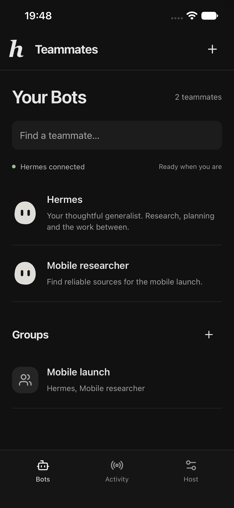
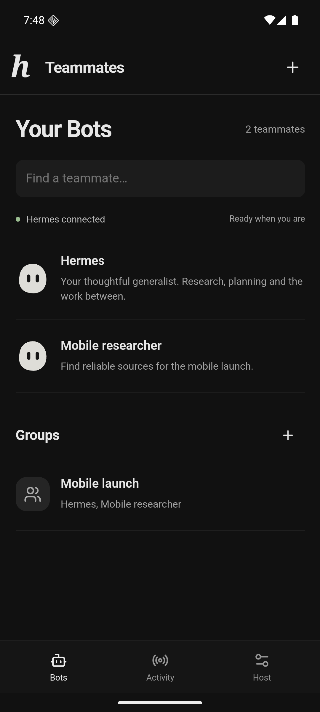

# Mobile verification

Mobile verification is separate from [desktop/runtime verification](verification.md).
The app uses the existing Hermes runtime on the host. It has no model runtime on
the device. Local inference fixtures prove protocol and tool wiring, not paid
provider access or model quality.

## Reproduce automated checks

```sh
npm ci
npm run format:check
npm run build
npm run build:mobile
npm test
npm run verify:mobile
```

The default tests include mobile pairing, expiry, one-use code replacement, token
hash persistence, owner-only device storage, revocation, Host/Origin rejection,
route restrictions and actual forwarding into a disposable backend. They also
check that mobile host input rejects HTTP, embedded credentials, paths and query
strings. Existing native tests exercise both compatible and Anthropic inference
protocols with controlled endpoints. Native tests skip if Hermes is absent.

`verify:mobile` needs Hermes and Playwright Chromium. It creates an owned fixture
host on ports 14310–14312. Stop another fixture before running it. A deterministic
model supplies replies while the installed native Hermes runtime executes the
question tool, persistent sessions, steering, Stop, routines and group members.
The browser supplies a stand-in for CapacitorHttp, validating HTTPS against the
fixture CA and omitting browser Origin. The production gateway has no CORS grant.
This browser lane does not prove native HTTP or secure storage.

The compiled browser flow covers pairing, roster and Bot creation, a real native
question, steering, answer, approval denial, Stop, memory editing, routine
creation/pause, a due routine question reached through Activity, group
creation and two attributed replies, device revocation, 390px overflow and page
errors. Screenshots go into ignored `test-artifacts/`.

For an interactive native acceptance host:

```sh
npm run mobile:sync
npm run mobile:fixture
```

This starts a disposable development workspace under ignored
`test-artifacts/mobile-host`, a local model fixture, loopback backend, HTTPS
gateway and compiled browser client. It generates a two-day local test certificate
and a five-minute pairing code. No provider key is required. The code stays in
`pairing.json` and is not printed. Generate another through the fixture's loopback
`POST /api/mobile/pairings` if it expires. This host is for local testing only;
its TLS listener is reachable on the host network. Stop it when finished and
remove its owned data when it is no longer needed. `TEAMMATES_MOBILE_FIXTURE_DIR`
selects a separate fixture data directory. Never point it at a personal profile.

## Native devices

Build iOS with simulator ad-hoc signing enabled. An unsigned executable compiled
with `CODE_SIGNING_ALLOWED=NO` can launch but fails Keychain writes. The app cancels
and revokes pairing if secure storage fails. A successful build alone therefore
does not prove native pairing.

```sh
xcodebuild -project mobile/ios/App/App.xcodeproj -scheme App \
  -configuration Debug -sdk iphonesimulator \
  -derivedDataPath test-artifacts/ios-build \
  CODE_SIGN_IDENTITY=- CODE_SIGNING_ALLOWED=YES build
```

Trust only the owned fixture certificate on a disposable simulator, for example
with `xcrun simctl keychain <udid> add-root-cert test-artifacts/mobile-host/cert.pem`.
Do not disable TLS validation in the app. For Android emulator access to this
localhost fixture use `adb -s <serial> reverse tcp:14311 tcp:14311`.

Android local CA testing can use an ignored `app/src/debug/` manifest and network
security resource that trusts the fixture CA in addition to system anchors.
Remove that local overlay after acceptance. It is not committed or used by a
release build. An alternative is a normally trusted TLS certificate for your own
host. Keep production cleartext rejection and certificate validation intact.

When working through T3, call `device_list`, then `device_open` for each platform.
Use exactly the returned agent-device launcher, device identifier, host config
and session on every command. Install the compiled `.app` or `.apk`, pair through
the actual form, open a Bot, send a task, answer its question, stop a second task,
then terminate and reopen the app to verify restored secure storage. Revoke access
on the host and confirm the phone returns to pairing. Record which steps passed
on each platform rather than inferring Android behavior from an iOS run.

## Evidence from this delivery

The implementation was exercised on an iPhone 17e simulator running iOS 27 and
an Android 16 ARM64 emulator, opened in T3's Device panel. Both used the compiled
native app, platform HTTPS, and actual installed Hermes on the host with controlled
local model inference. No live provider credential was used.

| Proof lane                 | Result                                                                                                                                                                                                |
| -------------------------- | ----------------------------------------------------------------------------------------------------------------------------------------------------------------------------------------------------- |
| Automated suite            | 13 passed, zero failed, one opt-in VM test skipped                                                                                                                                                    |
| Static and bundles         | Strict TypeScript, formatting, desktop production build and mobile production build passed                                                                                                            |
| Dependency audit           | `npm audit`: zero vulnerabilities in the locked npm dependency tree                                                                                                                                   |
| iOS native build           | Simulator build passed with ad-hoc signing and Swift Package Manager                                                                                                                                  |
| Android native build       | Debug and unsigned release APKs passed, including a clean build without the local CA overlay                                                                                                          |
| iOS device interaction     | HTTPS pairing, roster, private history, task send, native question/custom answer, reply, Stop, restored secure connection after restart/reinstall, host revocation back to pairing                    |
| Android device interaction | HTTPS pairing, roster, private history, task send, native question/choice answer, reply, Stop, restored secure connection after restart/reinstall, host revocation back to pairing                    |
| Compiled mobile browser    | Pairing, create Bot, question/answer, steering, approval denial, Stop, memory, routine pause, proactive question via Activity, group with two attributed replies, revocation, no overflow/page errors |
| Desktop regression         | Existing compiled browser and Electron acceptance passed, including native questions, approvals, steering, Stop, routines, proactive work, named/group conversations and durable unread behavior      |

Native roster captures from that controlled workspace:

| iOS simulator                               | Android emulator                                    |
| ------------------------------------------- | --------------------------------------------------- |
|  |  |

The Android screenshot includes the corrected dark system bars. The iOS app used
an ad-hoc-signed simulator build and a trusted fixture CA. Android used a debug
build with an ignored local CA resource, platform TLS validation and no cleartext
exception. That overlay was removed before the final clean debug/release build.
The source includes no test CA or TLS bypass. The two native device credentials
were revoked after acceptance and the owned host was stopped.

Pre-merge review added the iOS local-network permission explanation for hosts on
Wi-Fi. The ad-hoc-signed simulator build passed with the purpose string present
in its compiled Info.plist. The Wi-Fi permission prompt still needs a physical
device check; simulator localhost acceptance does not prove that permission flow.

Failures were retained and diagnosed during verification:

- The initial unsigned iOS executable launched but Keychain rejected writes. The
  app revoked the just-issued token and reported secure-storage failure. Enabling
  simulator ad-hoc signing fixed pairing; build success alone was insufficient.
- Android tooling was initially absent. SDK platform 36, Java 21 and an Android 16
  ARM64 AVD were prepared. A software-rendered emulator suffered a launcher ANR;
  restarting with hardware rendering and more memory restored normal interaction.
- T3 preview opened the compiled client, but two snapshots returned
  `Preview automation snapshot timed out after 15000ms.` The documented Playwright
  workflow supplied browser evidence after those failures.
- The first expanded proactive fixture put its trigger only in the routine prompt.
  Native cron delivery carries the routine name to Bot Chat; putting the fixture
  trigger in that name makes the test exercise the actual delivery contract.
- A routine on a Bot that had not started an interactive gateway used Hermes'
  single-query fallback, which cannot wait for an answer. The final question flow
  sends a fresh task after Stop and uses that active Bot, matching desktop acceptance. Fresh-host fallback
  remains an explicit backend limitation in the mobile setup guide.

## Remaining proof boundaries

Live Claude/OpenAI accounts, Claude login reuse, paid billing and provider model
quality require the operator's real authorized provider access. This delivery
uses no live provider credential. Existing native protocol tests cover both
Anthropic and OpenAI-compatible access with controlled endpoints; this is not a
live account claim. Physical devices, signed distribution, store review,
background notifications and another person's network/TLS deployment remain
separate verification. There is no push or background-work promise in this
release. The phone does not turn profile separation into an OS sandbox.

App-action and private-input cards reuse the desktop implementations. Mobile
native device acceptance directly exercised native questions and Stop; it did not
exercise an external MCP service, a real website login, or manual computer control.
The feature coverage table in [mobile setup](mobile.md) records those boundaries.
